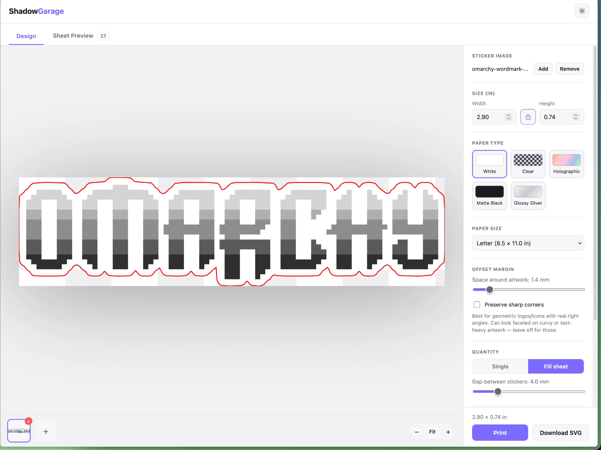
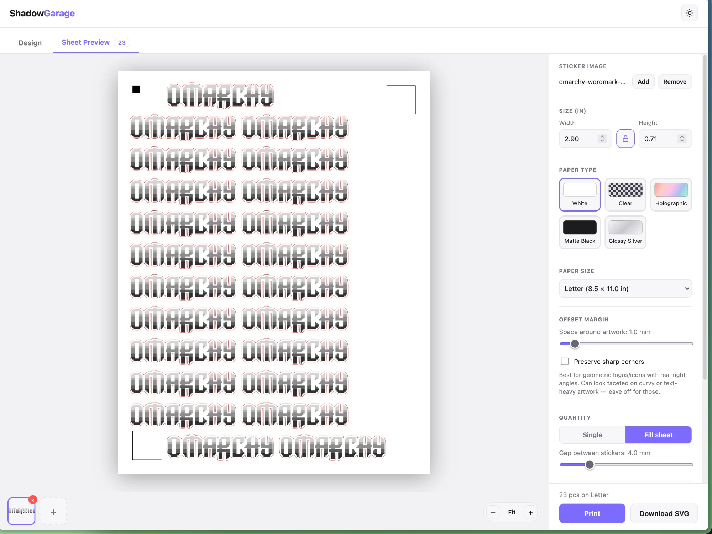

  

# Shadow Garage

*The self-hostable Silhouette Studio alternative — print-and-cut stickers, straight from your browser.*

**🔗 Live app: [https://spuder.github.io/shadow-garage/](https://spuder.github.io/shadow-garage/)**

Shadow Garage is the self-hostable, open-source alternative to Silhouette Studio for
print-and-cut stickers. It's a browser-only web app — static files, no backend, no install — that
turns a logo, wordmark, or image into a sticker sheet: it auto-traces a die-cut outline around
your artwork, packs the stickers onto a page with real Silhouette-style registration marks,
prints from the browser, and cuts on a Silhouette Cameo 3 or 4 directly over USB or Bluetooth. Use the
hosted copy above, or build it and serve it yourself.

## Why this exists

Getting stickers printed and cut on a Silhouette Cameo (or similar vinyl cutter) usually means
choosing between two bad options:

- **Silhouette Studio**, the official software, is paid — the print-and-cut workflow that
  actually matters is locked behind a Business/Designer Edition upgrade — and has a well-earned
  reputation for being buggy and unstable.
- **Inkscape + the [inkscape-silhouette](https://github.com/fablabnbg/inkscape-silhouette)
  extension** is free and open source, but notoriously fiddly to get working: Python environment
  issues, USB/driver quirks, and an extension UI with plenty of rough edges.

Shadow Garage replaces both for the sticker workflow. It handles the part that's genuinely
annoying to get right — turning an arbitrary image into a correctly-sized, correctly-registered
cut — entirely in the browser, with no install, and then drives the cutter itself over WebUSB or
Web Bluetooth (Chrome or Edge). It isn't a general-purpose design tool, and the Cameo 3 and 4 are
the only machines it cuts on so far. For anything else, download the SVG (marks included) and hand it
to whichever cutting path you've already got working: Silhouette Studio,
[Plottie](https://github.com/mossblaser/plottie) (a command-line tool that cuts/plots an SVG on a
Silhouette machine directly — no Silhouette Studio or Inkscape required, and it auto-detects
registration marks), or any other script that talks to the cutter.

  
  

## What it does

- **Upload one or more images** (PNG, JPEG, or SVG) — drag-and-drop or multi-select, with a
  thumbnail strip to manage them — or open a Silhouette Studio `.studio3` file.
- **Auto-traces a die-cut outline** around the artwork's alpha silhouette, with a margin/bleed
  you control. Disconnected pieces (separate letters in a wordmark, for example) get merged into
  one cuttable path; interior holes (the counter of an "O") are correctly left uncut, matching
  how real vinyl die-cuts are actually made. An optional "preserve sharp corners" mode keeps
  right angles crisp on geometric logos instead of rounding everything.
- **Resize by dragging a corner** directly on the canvas, or fine-tune exact Width/Height in the
  side panel with an aspect-ratio lock (or unlock it to deliberately stretch).
- **Pack multiple stickers onto a sheet** (Letter / A4 / A3) — one of each, or auto-filled to
  cover the page — with a live preview and per-sticker delete/resize right on the sheet.
- **Import Silhouette Studio `.studio3` files** — every sticker in the file (artwork plus its cut
  outline) arrives as its own object, exactly where Studio had it, instead of one flattened
  picture. Drag stickers around the sheet, resize or delete them, add more images beside them,
  then print and cut from here — or **export the `.studio3`** to save those changes back into the
  file for Studio. See [Silhouette Studio files](#silhouette-studio-files) for what's supported.
- **Silhouette-style registration marks** — Standard (3-mark) or Four-corner — with sticker
  placement automatically kept clear of the marks so nothing overlaps or obscures them.
- **Print directly** to your system print dialog at true physical size, or **download the SVG**
  for use elsewhere.
- **Cut directly on a Silhouette Cameo 3 or 4** over USB or Bluetooth from Chrome or Edge — see
  [docs/cutter-setup.md](docs/cutter-setup.md).
- Paper types (White sticker / Clear sticker / 20 lb printer paper), each with its own cut
  settings, and a dark/light theme.

## Silhouette Studio files

Silhouette doesn't document the `.studio3` format, so support here was worked out from real
files and is deliberately narrow:

- **Import** reads files saved by Silhouette Studio 5. It brings in stickers — an image with a
  cut outline around it, such as a traced PNG — along with the page size. The outline comes from
  the file, so the Offset Margin control doesn't apply to imported stickers. Other objects
  (text, plain shapes, rotated or mirrored stickers, artwork in a format a browser can't draw)
  aren't shown yet; the status line says how many were left out.
- **Placement is automatic.** A sticker closer to the edge than the cutter can reach, or sitting on
  a registration mark, is moved the shortest distance that fixes it, and the packer keeps added
  stickers the usual gap away from every side of the imported ones. There's nothing to confirm.
- **Export** writes your changes back into the file you imported: stickers you moved, resized or
  deleted. Everything it doesn't touch — layers, cut settings, objects it couldn't show — is kept
  byte for byte, so nothing is lost on the way back to Studio. Stickers added in Shadow Garage
  can't be written to a `.studio3` yet, and neither can a sheet that didn't start from one; use
  **Download SVG** for those.
- The file's stored preview thumbnail isn't redrawn, so a file browser may show the old layout
  until Studio saves the file again. Studio also keeps a cached cut job in the file (its path data
  and bounding box) that isn't updated either. Moves and deletes were checked against files saved
  by Studio itself, and match them apart from that cache; whether Studio rebuilds the cache when it
  opens an exported file hasn't been confirmed, so look at the cut preview before sending one.

## Supported cutters

Direct cutting is confirmed only on the hardware that contributors own. Each row shows what a
person has run on a real machine.

| Cutter | USB | Bluetooth | Bed width used |
|---|---|---|---|
| Silhouette Cameo 3 | ✅ Tested | ✅ Tested | 12 in (304.8 mm) |
| Silhouette Cameo 4 | ⚠️ Not confirmed | ✅ Mark scan and dry run tested (Bluetooth LE) | 12 in (304.8 mm) |
| Silhouette Cameo 4 Plus | ❌ Not recognised | 🧪 Untested — connects as a Cameo 4 | 12 in, not the full 15 in |
| Silhouette Cameo 4 Pro | ❌ Not recognised | 🧪 Untested — connects as a Cameo 4 | 12 in, not the full 24 in |
| Other models (Cameo 5, Portrait 3, …) | ❌ Not supported | ❌ Not supported | — |

**Testers wanted.** If you have a Cameo 4 Plus or Pro, or can fill in a ⚠️ cell above, connect
the cutter, run a **Dry run**, push **Copy log**, and
[open an issue](https://github.com/spuder/shadow-garage/issues) with the log. See
[docs/cutter-setup.md](docs/cutter-setup.md) for setup, and its "Current limitations" section for
what is still open.

### Checklist

- [x] Cameo 3 over USB: print and cut
- [x] Cameo 3 over Bluetooth
- [ ] Cameo 4 over USB
- [x] Cameo 4 over Bluetooth LE: mark scan and dry run
- [ ] Cameo 4: real cuts confirmed
- [ ] Cameo 4 Plus (USB id and 15 in bed)
- [ ] Cameo 4 Pro (USB id and 24 in bed)

## License

MIT — see [LICENSE](LICENSE).
